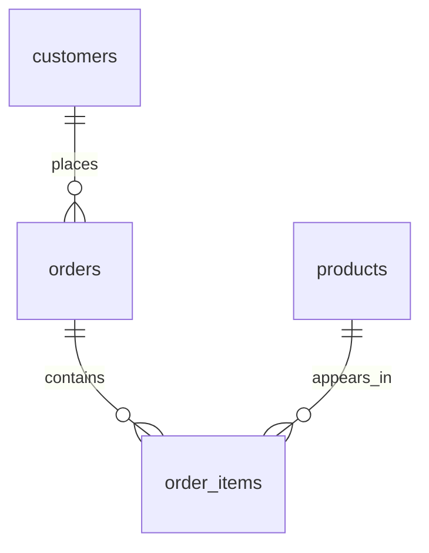

# The shop model

| Table | One row represents | Primary key |
|-------|--------------------|-------------|
| customers | One customer | customer_id |
| products | One catalog product | product_id |
| orders | One order header | order_id |
| order_items | One distinct product within an order | (order_id, product_id) |

An order can contain many products. A product can appear in many orders.
`order_items` resolves that many-to-many relationship. The composite primary
key means a product appears at most once per order; quantity records units.

A primary key uniquely identifies a row and cannot be NULL. Foreign keys
ensure each referenced customer, order, or product exists. This schema uses
the default restrictive delete behavior: remove children before parents.
MySQL/InnoDB checks these relationships immediately, not at COMMIT.

`DECIMAL(10,2)` stores exact fixed-point prices: ten total digits, two after
the decimal point. Avoid FLOAT for exact money calculations. Integer types
suit counts and identifiers; VARCHAR suits variable-length text. Phone
numbers are text because they can include plus signs and leading zeros.
DATE stores a date; DATETIME here stores UTC by application convention,
without doing timezone conversion itself. `ordered_at` must be supplied in UTC.

`order_items.unit_price` preserves the purchase price even if the catalog
price changes. Revenue is `quantity * unit_price`, never the current product
price. Tax, shipping, refunds, and currency conversion are outside this model.

NOT NULL, UNIQUE, CHECK, and foreign keys protect data integrity. CHECK alone
does not reject NULL: pair it with NOT NULL when a value is required.
The utf8mb4 collation used here compares text without case or accent
sensitivity; that also affects email uniqueness and LIKE comparisons.

AUTO_INCREMENT generates identifiers; gaps are normal, including after a
rollback. An identifier is not a row count or a guaranteed timeline.
InnoDB provides transactions and foreign keys for these tables.

The customer foreign-key index on orders is explicitly named. This keeps it
in place while lesson 19 temporarily adds and removes a wider composite index;
InnoDB may otherwise replace an automatically generated foreign-key index.
Each seeded order has at least one line. The schema allows empty order headers;
these reports assume an order has items before it becomes paid or shipped.
